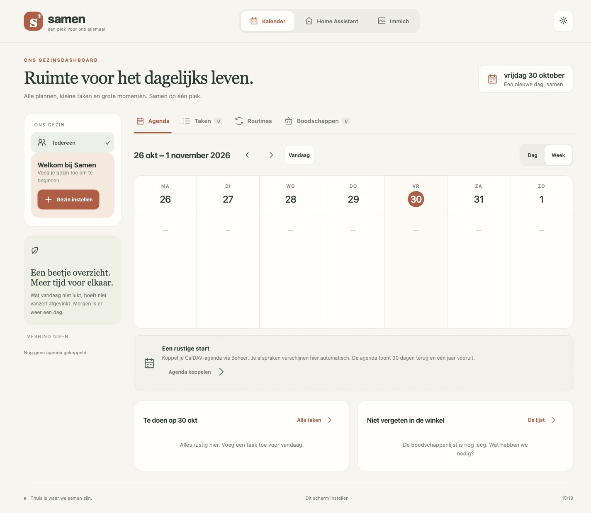

# Samen · lokaal gezinsdashboard

Een rustige, Nederlandstalige plek voor agenda, taken, routines, boodschappen en herinneringen. Zelf te hosten, zonder abonnement, NAS-afhankelijkheid of externe frontenddiensten.

**Versie 0.3.0 — met kinderspellen, routineplanning en automatische dagwisseling.** De lokale gezinsplanner is bruikbaar. De eigenaar heeft de agenda-integratie, Home Assistant en Immich handmatig gevalideerd; specifieke randgevallen en technische P0-acceptatie staan nog open. Zie [verificatie en beperkingen](docs/VERIFICATION.md) en het [requirements- en TODO-overzicht](docs/REQUIREMENTS.md).



## Wat werkt

- Vaste hoofdnavigatie: Kalender, Spelletjes, Home Assistant, Immich en Boodschappen. Eén gedeelde datumselectie boven het gezinsfilter voor agenda, taken, routines en beloningen. Nederlandse datums, maandag als weekstart, 24-uursklok en instelbare tijdzone.
- De vaste datumweergave toont een analoge klok met cijfers 1–12 en de eerstvolgende agenda-afspraak.
- Gezinsleden met naam, kleur en emoji-avatar; gezamenlijk overzicht of filter per persoon.
- Beheerbare headerbranding: pas titel en subtitel aan en upload een gezinsfoto als logo.
- Dag- en weekagenda toont lokale taakuitvoeringen op hun geplande dagen, met voltooiing direct vanuit de agenda. CalDAV is optioneel voor privéafspraken; de gezinsplanner werkt ook zonder gekoppelde agenda.
- CalDAV-accountbeheer, agenda-ontdekking, selectie en gezinskoppeling. Alleen-lezen privéafspraken met herhalingen, uitzonderingen en tijdzones.
- Taken met beschrijving, datum, icoon, punten per uitvoering, dag/weekherhaling en individuele of gezamenlijke uitvoering.
- Routines met geordende stappen, personen, weekdagen en een optioneel tijdvenster. Punten worden één keer toegekend als alle stappen af zijn; elke ingeplande kalenderdag heeft per persoon een eigen uitvoering die onafgevinkt begint. Op niet-ingeplande weekdagen is er geen uitvoering. Voortgang en afvinktijdstippen blijven server-side bewaard; blader met de datumknoppen terug om de voortgang van eerdere dagen te zien. Gemiste stappen blijven op hun eigen dag open.
- Kindmodus voor een gedeeld scherm: persoonlijke taken, routinevoortgang en beloningen van vandaag met grote bediening. De volledige datum staat bij de begroeting. Bij een nieuwe dag (ook na sluimerstand) verschijnen automatisch de taken en routines van vandaag in de ingestelde tijdzone; eerdere voortgang blijft op de oorspronkelijke datum bewaard. De ouderweergave schuift mee als die op vandaag stond; een bewust gekozen andere datum blijft geselecteerd. De kindmodus verbergt ouderbeheer, maar is geen beveiligingsgrens.
- Gedeelde boodschappen met hoeveelheid, notitie, bewerken, afvinken, herstellen en opruimen.
- Automatische verversing elke 1,5 seconde; versienummers voorkomen stil overschrijven. Dubbele verzoeken worden herkend.
- Beveiligd beheer, server-side integratiegeheimen, historie, SQLite-back-up en healthcheck.
- Puntensaldi en herleidbare transacties per gezinslid, beheerbare beloningen, aanvragen met gereserveerde punten en oudergoedkeuring. Ouders kunnen het saldo per gezinslid corrigeren; een reden is optioneel en gereserveerde punten blijven beschermd. Een voltooiing ongedaan maken boekt de bijbehorende punten terug.
- Home Assistant-dashboard rechtstreeks ingesloten vanuit het zelfgekozen HA-dashboardpad. Immich-fotolijst uit geselecteerde albums, pauze/vorige/volgende, voorladen, begrensde servercache en schermspecifieke voorkeuren.

Beloningsaanvragen zijn zichtbaar voor het gezin; het gezinsprofiel is een filter en geen authenticatie. De kindmodus vereenvoudigt de bediening maar biedt geen toegangsbeveiliging. Alleen een beheerder kan de beloningscatalogus beheren en aanvragen goedkeuren. Recepten en maaltijdplanning zijn niet opgenomen.

## Installeren via Docker Hub

De kant-en-klare image staat op [Docker Hub: ruudv/family-dashboard](https://hub.docker.com/r/ruudv/family-dashboard).
Je hoeft de broncode niet te downloaden of zelf te bouwen.

Compose gebruikt standaard `ruudv/family-dashboard:latest`. De image ondersteunt
**Linux amd64 (Intel/AMD 64-bit)**, waaronder de Synology DS918+, en **Linux arm64**.
Zet `DASHBOARD_IMAGE=ruudv/family-dashboard:0.3.0` om een versie vast te zetten.

### Docker Compose

Benodigd: een Docker-host met Docker Compose v2. Maak een lege installatiemap en
sla onderstaande configuratie op als `compose.yaml`:

```yaml
services:
  storage-init:
    image: ${DASHBOARD_IMAGE:-ruudv/family-dashboard:latest}
    user: "0:0"
    command:
      - python
      - -c
      - |
        import os, stat
        def fail(error):
            raise error
        for directory in ("/data", "/cache"):
            for _, _, files, parent in os.fwalk(directory, follow_symlinks=False, onerror=fail):
                os.fchown(parent, 10001, 10001)
                os.fchmod(parent, 0o700)
                for name in files:
                    if not stat.S_ISREG(os.stat(name, dir_fd=parent, follow_symlinks=False).st_mode):
                        continue
                    fd = os.open(name, os.O_RDONLY | os.O_NOFOLLOW | os.O_NONBLOCK, dir_fd=parent)
                    try:
                        info = os.fstat(fd)
                        if not stat.S_ISREG(info.st_mode) or info.st_nlink != 1:
                            raise RuntimeError("Opslag bevat een onveilig bestand of hardlink")
                        os.fchown(fd, 10001, 10001)
                        os.fchmod(fd, 0o600)
                    finally:
                        os.close(fd)
    volumes: &storage
      - ${DATA_VOLUME:-family-data}:/data
      - ${CACHE_VOLUME:-family-cache}:/cache
    network_mode: none
    read_only: true
    cap_drop: [ALL]
    cap_add: [CHOWN, FOWNER, DAC_OVERRIDE]
    security_opt:
      - no-new-privileges:true
    healthcheck:
      disable: true
    restart: "no"
  dashboard:
    image: ${DASHBOARD_IMAGE:-ruudv/family-dashboard:latest}
    depends_on:
      storage-init:
        condition: service_completed_successfully
    ports:
      - "${PORT:-8080}:8080"
    environment:
      ADMIN_PASSWORD: ${ADMIN_PASSWORD:?Stel ADMIN_PASSWORD in via .env}
      TZ: ${TZ:-Europe/Amsterdam}
      COOKIE_SECURE: ${COOKIE_SECURE:-false}
      CACHE_MB: ${CACHE_MB:-128}
      DATA_DIR: /data
      CACHE_DIR: /cache
    volumes: *storage
    restart: unless-stopped
    init: true
    read_only: true
    tmpfs:
      - /tmp:size=32m
    cap_drop: [ALL]
    security_opt:
      - no-new-privileges:true
volumes:
  family-data:
  family-cache:
```

Maak daarnaast een bestand `.env` met een eigen, uniek beheerwachtwoord:

```dotenv
ADMIN_PASSWORD=kies-hier-een-eigen-uniek-wachtwoord
PORT=8080
TZ=Europe/Amsterdam
COOKIE_SECURE=false
CACHE_MB=128
```

Start vanuit die map:

```sh
docker compose pull
docker compose up -d
docker compose ps
```

Open `http://<serveradres>:8080`, open beheer en meld je aan met je gekozen
wachtwoord. Voeg daarna je gezinsleden toe. Een nieuwe installatie start leeg;
CalDAV, Home Assistant en Immich zijn optioneel.

### Portainer / Synology

Kies in de Docker-omgeving van Portainer **Stacks → Add stack → Web editor**,
geef de stack bijvoorbeeld de naam `family-dashboard` en plak dezelfde YAML.
Voeg onder **Environment variables** de waarden uit het bovenstaande
`.env`-voorbeeld toe, met je eigen `ADMIN_PASSWORD`. Je kunt hiervoor ook
**Load variables from .env file** gebruiken. Klik daarna op **Deploy the stack**.

De benoemde volumes worden door Docker aangemaakt; handmatig mappen maken op de
NAS is voor deze configuratie niet nodig. Bij een private Docker Hub-repository
moet je eerst Docker Hub met je account toevoegen aan de registries in Portainer.
Voor installatie door anderen zonder account moet de image-repository publiek zijn.

Voor Portainer en de opdrachtregel gebruik je hetzelfde [compose.yaml](compose.yaml).
Er is geen apart Portainer-bestand nodig. Standaard gebruikt het Docker-volumes.
Wil je eigen hostmappen, stel dan in Portainer **beide** variabelen in op absolute
paden van de Docker-host:

```dotenv
DATA_VOLUME=/srv/family-dashboard/data
CACHE_VOLUME=/srv/family-dashboard/cache
```

Dit zijn generieke voorbeelden: vervang ze door je eigen bestaande opslagpaden.
Stel `PORT` in op de poort waarop je bestaande installatie bereikbaar is.
**Bij overstappen van een oudere Portainer-configuratie:** behoud dezelfde stacknaam,
zet de bestaande `source` van `/data` in `DATA_VOLUME`, die van `/cache` in
`CACHE_VOLUME`, en behoud `PORT` en `ADMIN_PASSWORD`. De oude `STORAGE_ROOT`-variabele
wordt niet meer gebruikt. Zonder de padvariabelen gebruikt Compose de standaardvolumes;
je bestaande gegevens worden dan niet automatisch meegenomen.

Gebruik aparte lokale mappen voor deze applicatie. Bij de korte volumesyntax kan
Docker een ontbrekende hostmap automatisch aanmaken; controleer de paden dus vóór
deployment om een onbedoelde lege installatie te voorkomen. Eigen paden en geheimen
horen uitsluitend in je lokale `.env` of Portainer, niet in de gedeelde YAML.

### Waarom een tijdelijke opslagcontainer?

De service `storage-init` bereidt bij deployment beide opslagmappen inclusief
submappen en gewone bestanden voor: UID/GID 10001, maprechten 0700 en bestandsrechten
0600. Dit voorkomt de SQLite-opstartfout bij lege hostmappen die van een andere
gebruiker zijn, zonder handmatig `chown` uit te voeren. Hiervoor draait alleen
de korte voorbereidingsservice als root, met uitsluitend `CHOWN`, `FOWNER` en `DAC_OVERRIDE`, zonder
netwerk of beheerwachtwoord. Het dashboard wacht op een geslaagde voorbereiding en
blijft als gewone gebruiker draaien, zonder extra capabilities.
`storage-init` met status **Exited (0)** is normaal; de container blijft zichtbaar
als gestopte service. Hij is tijdelijk actief en wordt niet automatisch verwijderd.
Alleen `dashboard` blijft actief.

We houden deze werkende oplossing aan om de extra rechten buiten de webappcontainer
te houden en dezelfde bestaande image te kunnen gebruiken. Het is een bewuste afweging:
de Compose-configuratie krijgt één service en een opstartafhankelijkheid erbij.
Een opstartscript binnen de image is ook mogelijk, maar is voor deze installatie niet
nodig. Dit is geen verplicht Docker-patroon en de hulpservice is geen databaseserver.

Er hoeft geen database klaar te staan: het dashboard maakt `family.db` met het schema
en lege begininstellingen zelf aan. Bestaande databasebestanden worden niet vervangen.
Ook een teruggezette database en eventuele SQLite-nevenbestanden krijgen de juiste
eigenaar en rechten. De inhoud blijft ongewijzigd. Stop het dashboard voordat je een
consistente databaseback-up terugzet en laat daarna `storage-init` opnieuw uitvoeren
door de stack te deployen. Zie [Back-up en herstel](#back-up-en-herstel).

De voorbereiding volgt geen symbolische links en slaat speciale bestanden over.
Hardlinks naar gewone bestanden worden geweigerd, zodat een eigenaarswijziging niet
via een gedeelde inode buiten de opslag doorwerkt. `DAC_OVERRIDE` is alleen tijdens
de voorbereiding nodig om ook afgeschermde submappen en teruggezette bestanden te
kunnen openen. Gebruik daarom uitsluitend eigen opslagmappen voor deze applicatie.
Als het bestandssysteem eigenaarswijzigingen weigert (bijvoorbeeld door NAS-ACL's of
een netwerkshare), faalt de voorbereiding en start het dashboard niet. Controleer
dan de logs van `storage-init` en de NAS-rechten; SQLite hoort op lokale NAS-opslag.
Deze opstartafhankelijkheid vereist Docker Compose / Portainer Docker Standalone,
niet Docker Swarm.

### Opslag, bestaande instellingen en updates

`/data` bevat de SQLite-database met gezinsgegevens, gezamenlijke instellingen en
integratiegeheimen. `/cache` bevat vervangbare foto's. Beide staan in volumes en
blijven bij containervervanging behouden. Gebruik **geen** `docker compose down -v`:
dat verwijdert de volumes.

Een bestaande configuratie verhuis je via een consistente databaseback-up,
plus je eigen omgevingsvariabelen. Volg [Back-up en herstel](#back-up-en-herstel);
kopieer geen live databasebestand. Browservoorkeuren onder **Dit apparaat**
worden bij een nieuw adres opnieuw ingesteld. Bij herstel is
`family-backup.db` de naam van je back-upbestand, niet de naam van de actieve database.

Maak vóór een update een back-up en voer `docker compose pull` en
`docker compose up -d` uit. Gebruik je een vaste versietag, wijzig die dan eerst
naar de gewenste versie. Kies in Portainer **Update the stack** en laat Portainer
de image opnieuw ophalen.
Behoud dezelfde stacknaam en volumes. Herlaad na de update het dashboard op
apparaten waar het nog openstaat. Gewijzigde frontendbestanden krijgen een
nieuw adres, zodat de browser de bijbehorende navigatie en opmaak ophaalt.

Gebruik deze versie op een vertrouwd thuisnetwerk en stel geen publieke
router-port-forward in. Stel `COOKIE_SECURE=true` in als je uitsluitend HTTPS gebruikt.
Zie [Configuratie](#configuratie) voor eigen opslagpaden en schrijfrechten.

## Zelf bouwen met Docker Compose

Benodigd: Docker Engine met Compose v2. Met de Dockerfile kun je zelf voor Linux amd64 of arm64 bouwen. De Docker Hub-image voor 0.3.0 ondersteunt amd64 en arm64. Beide builds en containerstart zijn lokaal op een Mac gecontroleerd, amd64 via emulatie. Uitvoering op een fysieke NAS is nog niet geverifieerd. Er zijn geen Node-, Python- of NAS-ontwikkeltools op de Docker-host nodig.

1. Clone [de GitHub-repository](https://github.com/ruudverheijden/family-dashboard) of kopieer deze projectmap naar de server.
2. Kopieer `.env.example` naar `.env`. Vervang `ADMIN_PASSWORD` door een eigen wachtwoord. Pas eventueel `PORT` aan.
3. Start in de projectmap:

   ```sh
   BUILDX_GIT_INFO=false docker build -t family-dashboard:local .
   DASHBOARD_IMAGE=family-dashboard:local docker compose up -d --pull never
   docker compose ps
   ```

4. Open `http://<serveradres>:8080` in een browser (of de ingestelde poort). Open de beheerknop rechtsboven, meld je aan en voeg gezinsleden toe. De app start leeg: geen fictief gezin en geen voorbeeldafspraken in je echte database.

De standaardpoort luistert op de netwerkinterfaces van de Docker-host. Beperk inkomend verkeer met de hostfirewall tot je vertrouwde thuisnetwerk en stel geen router-port-forward of andere publieke toegang in. Gebruik deze versie alleen op een vertrouwd thuisnetwerk. Een internetverbinding is alleen nodig voor installatie/updates of wanneer de gekozen integraties extern draaien. Lokale taken, routines en boodschappen werken zonder internet zolang de server bereikbaar is.

## Configuratie

| Instelling | Plaats | Betekenis |
|---|---|---|
| `ADMIN_PASSWORD` | `.env` | Beheerwachtwoord; wijzigen vereist containerherstart |
| `DASHBOARD_IMAGE` | `.env` / Portainer | Image voor beide services; standaard `ruudv/family-dashboard:latest` |
| `DATA_VOLUME`, `CACHE_VOLUME` | `.env` / Portainer | Optionele absolute hostpaden; standaard benoemde Docker-volumes |
| `PORT` | `.env` | Gepubliceerde poort; standaard 8080 |
| `TZ` | `.env` | Containertijdzone; standaard Europe/Amsterdam |
| Tijdzone | Beheer | Functionele agenda-/uitvoeringstijdzone, standaard Europe/Amsterdam |
| Logo en teksten | Beheer → Algemeen | Titel, subtitel en gezinsfoto voor de header; foto’s worden verkleind in SQLite opgeslagen |
| `COOKIE_SECURE` | `.env` | `true` bij uitsluitend HTTPS; standaard `false` voor lokaal HTTP |
| `CACHE_MB` | `.env` | Bovengrens vervangbare fotocache; standaard 128 MB |
| CalDAV, HA en Immich | Beheer | Gezamenlijke instellingen, persistent in SQLite |
| Inactiviteit, shuffle, uitsnijden | Beheer → Dit apparaat | Alleen deze browser, in localStorage |

De volumes `family-data` en `family-cache` bevatten respectievelijk database/configuratie en vervangbare foto’s. Compose geeft ze een projectprefix. Voor eigen opslagpaden kunnen de volumemounts worden gewijzigd; de container draait als UID/GID 10001 en moet daar kunnen schrijven. Gebruik een lokale schijf voor SQLite, geen databasebestand op SMB/NFS.

### Optionele privéagenda via CalDAV

Een CalDAV-koppeling is niet nodig voor de gezinsplanner: taken en routines worden lokaal beheerd en verschijnen vanzelf op hun geplande datum in het agendaoverzicht. Voeg alleen een CalDAV-account toe als je ook privéafspraken uit een externe agenda wilt zien.

Open **Beheer → Account toevoegen**, vul een CalDAV-serveradres, gebruikersnaam en wachtwoord in en kies **Agenda’s ophalen**. Selecteer agenda’s, wijs een gezinslid toe en sla op. Meerdere accounts zijn mogelijk. Bij hetzelfde serveradres behoudt een leeg wachtwoord het bestaande geheim. Vul bij wijziging van het CalDAV-serveradres opnieuw het wachtwoord in; verwijderen van het account verwijdert ook de gekoppelde lokale agenda’s.

Synchronisatie gebeurt bij het starten en daarna elke drie minuten (plus looptijd), of met **Nu synchroniseren**. Ook die knop respecteert voor CalDAV de minimumafstand van drie minuten tussen synchronisatiestarts. De app vervangt de lokale kopie pas nadat alle geselecteerde agenda’s van dat account succesvol zijn opgehaald. Wijzigingen en verwijderingen worden zo zonder extra kopieën verwerkt. Bij fouten blijft de vorige kopie staan en worden fout en laatste succesmoment getoond. Het venster loopt van 90 dagen terug tot ongeveer één jaar vooruit. Agenda’s daarbuiten worden niet geladen.

Afspraken worden niet lokaal aangemaakt of gewijzigd; CalDAV blijft de bron. Raadpleeg de [python-caldav zoekdocumentatie](https://caldav.readthedocs.io/stable/caldav/collection.html) voor het gebruikte protocolpad. De gebruikte bibliotheek verwerkt herhalingen lokaal met `recurring-ical-events`.

### Home Assistant

Het HA-tabblad toont je Home Assistant-dashboard rechtstreeks in Samen. De bovenbalk met navigatie blijft staan; het dashboard gebruikt de rest van het scherm. De app haalt geen HA-entiteiten op en rendert ze niet zelf; je maakt en beheert de inhoud en bediening volledig in Home Assistant.

1. Open **Beheer → Home Assistant-dashboard**.
2. Vul het HA-serveradres in, bijvoorbeeld `http://homeassistant.local:8123` (zonder `/api` of dashboardpad).
3. Stel het dashboardpad in. Standaard is dit `/lovelace/0`; voor een eigen dashboard gebruik je het pad uit Home Assistant, bijvoorbeeld `/dashboard-gezinsdashboard/overzicht`.
4. Sla de instellingen op en open de tab **Home Assistant**.

Je browser moet het ingestelde HA-adres kunnen bereiken en zo nodig al bij Home Assistant zijn aangemeld. Het HA-dashboard wordt schermvullend onder de bovenbalk getoond; de browser- en HA-configuratie moeten insluiten toestaan. Gebruik op niet-vertrouwde netwerken HTTPS voor zowel Samen als Home Assistant.

Krijg je in Firefox de melding dat Home Assistant niet in een andere website mag worden ingesloten? Dan weigert de HA-server dit via `X-Frame-Options`; Samen kan die beveiligingsheader niet omzeilen. In Home Assistant 2026.8 en nieuwer kun je dit aanpassen via **Instellingen → Systeem → Netwerk → HTTP-server**: schakel **Send X-Frame-Options** uit en bevestig de herstart. In oudere versies voeg je aan `configuration.yaml` toe:

```yaml
http:
  use_x_frame_options: false
```

Herstart Home Assistant daarna. Gebruik dit alleen op een vertrouwd netwerk: uitschakelen vermindert bescherming tegen clickjacking. Als Home Assistant achter een reverse proxy staat, controleer dan ook of die niet zelf `X-Frame-Options` of een beperkende CSP `frame-ancestors`-header toevoegt.

### Immich

Vul het basisadres **zonder `/api`** en een beperkte lees-API-sleutel met **`album.read`, `asset.read` en `asset.view`** in. Voer bij wijziging van het Immich-serveradres de API-sleutel opnieuw in. Kies **Albums ophalen**, selecteer expliciet de gewenste albums en sla op. Zonder selectie worden geen foto’s getoond. Oudere Immich-versies leveren foto's bij de albuminformatie; bij nieuwere versies haalt het dashboard alle pagina's op via `/api/search/metadata`, gefilterd op het geselecteerde album. Voor previews gebruikt het dashboard [asset previews](https://api.immich.app/endpoints/assets/viewAsset).

De backend vraagt previewafbeeldingen op (geen originele bestanden), bewaart maximaal de ingestelde cacheomvang en verwijdert cachebestanden zodra foto’s uit de toegestane selectie verdwijnen. De albums worden elke drie minuten vernieuwd. Als albumrechten niet gecontroleerd kunnen worden, stopt de fotolijst en wordt de cache geleegd. Afbeeldingen worden niet blijvend in de browsercache opgeslagen. De bronalbums en foto’s worden nooit gewijzigd. De Immich-fotolijst gebruikt, net als het HA-tabblad, de volledige ruimte onder de bovenbalk; de diavoorstellingsbediening ligt over de foto.

Onder **Beheer → Dit apparaat** kun je een inactiviteitstimer aanzetten. Standaard is deze uit. Open formulieren, niet-opgeslagen boodschappen en het routinescherm verhinderen automatisch wisselen. Aanrakingen in de geïntegreerde HA-weergave tellen mee als activiteit.

## Uitvoeringen, conflicten en historie

Sjablonen en uitvoeringen zijn aparte records. Een achtergrondtaak maakt verlopen uitvoeringen aan tot vandaag (inhaalperiode maximaal twee jaar); niets wordt automatisch voltooid. Een gekozen datum maakt ook de bijbehorende uitvoeringen aan. Elke uitvoering bevat een snapshot van het sjabloon. Bij routines volgen toekomstige uitvoeringen zonder vinkjes, afvinkhistorie of puntenboekingen de actuele naam, stappen, personen, dagen en tijdvensters, ook als je die dagen al eerder hebt bekeken. Een oude geopende kaart moet eerst de nieuwe planning ophalen voordat je daarop verder kunt afvinken. Uitvoeringen van vandaag en eerdere dagen, en elke uitvoering met voortgang of afvinkhistorie, behouden hun snapshot. Ook na heropenen blijft die historie beschermd. Geannuleerde toekomstige uitvoeringen zonder voortgang verdwijnen uit de planning; hun opslagrecord blijft behouden. Bestaande taakuitvoeringen behouden hun snapshot bij bewerken en archiveren. In het takenoverzicht worden wel de actuele titel, het pictogram, de beschrijving en punten van het sjabloon getoond, zodat een bewerkte taak direct herkenbaar is.

Het routineoverzicht toont uitsluitend routines voor de geselecteerde dag. Een lege dag
biedt een knop naar de eerstvolgende ingeplande routinedag voor het gekozen gezinsfilter,
wanneer die bestaat. **Routines beheren** toont de volledige planning met personen,
weekdagen, startdatum en tijdvensters; daar kun je routines bewerken of archiveren.

De weekagenda loopt van maandag tot en met zondag. Routines verschijnen vanaf
hun ingestelde startdatum op de gekozen weekdagen. Op zondag staan de komende
dagen dus in **Volgende week**, of kies **3 dagen** om vandaag en de twee volgende
dagen te zien. Teruggaan van Routines naar Agenda laadt direct het volledige
zichtbare bereik.

In de agenda staan routines met tijdvenster tussen de afspraken, met een eigen
routinepictogram en omlijning. Routines zonder tijdvenster staan boven het rooster.
Schakel bij het maken of bewerken **Tijdvenster gebruiken** uit voor een routine
zonder vaste tijd. Het leegmaken van beide tijdvelden schakelt dit ook uit. De kaarten tonen personen en voortgang; afgeronde routines blijven zichtbaar
als **Klaar**. Open een kaart om de stappen in een paneel af te vinken of te heropenen.
Dat gebruikt dezelfde dagelijkse voortgang als het routineoverzicht en de kindmodus.
Bij een kaart op een andere dag verandert ook de gedeelde datumselectie. Sluiten of
Escape brengt je terug naar de agenda. Een opslagfout wordt in het paneel getoond.

Een routinevenster is een aanwijzing, geen blokkering: je kunt een stap later alsnog afvinken. Vensters over middernacht worden in deze versie niet ondersteund. Niet-afgeronde taken blijven op hun eigen datum zichtbaar; er is nog geen apart overzicht voor alle achterstallige taken.

Wijzigingen gebruiken versienummers. Bij een conflict wordt de wijziging afgewezen en de nieuwste staat opgehaald. Formulierinvoer blijft staan; sluit het formulier en open het item opnieuw voordat je de wijziging opnieuw toepast. Gelijktijdig dezelfde taak voltooien levert één statuswijziging en één historie-item op. Identieke opnieuw verstuurde verzoeken met hetzelfde verzoeknummer worden niet opnieuw uitgevoerd.

Bij verbindingsverlies wordt geen succesvolle opslag gemeld. Er is geen offline wachtrij. Een verlopen beheersessie kan opnieuw worden geopend; bestaande integratiegeheimen komen niet naar de browser terug.

## Back-up en herstel

De SQLite-back-up bevat gezinsgegevens, uitvoeringen, puntenledger, beloningsaanvragen, spelprijzen, spelsessies, historie en integratiegeheimen. Bewaar hem privé en versleuteld; neem ook `.env` en eventuele aangepaste Compose-configuratie mee. Foto’s in de cache hoeven niet te worden geback-upt.

Consistente online back-up (gebruik een nieuwe bestandsnaam per back-up):

```sh
mkdir -p backups
docker compose exec dashboard python -m app.backup /tmp/family-backup.db
docker compose cp dashboard:/tmp/family-backup.db ./backups/family-backup.db
```

Het script gebruikt de SQLite Backup API en voert `integrity_check` uit. Het weigert een bestaand doelbestand te overschrijven. Bij een volgende back-up kies je een andere naam; `/tmp` wordt ook gewist bij containervervanging.

Herstel naar een lege installatie, vanuit de projectmap:

```sh
docker compose stop dashboard
docker compose run --rm --no-deps --user root \
  --cap-add DAC_OVERRIDE --cap-add CHOWN --cap-add FOWNER \
  -v "$(pwd)/backups:/restore:ro" dashboard \
  python -c "import pathlib,shutil,os; p=pathlib.Path('/data/family.db'); assert not p.exists(), 'Doel is niet leeg'; shutil.copyfile('/restore/family-backup.db',p); os.chown(p,10001,10001); os.chmod(p,0o600)"
docker compose up -d
```

Gebruik voor herstel een leeg datavolume. Behoud de oude installatie tot je de nieuwe hebt gecontroleerd. Controleer daarna gezinsleden, boodschappen, routinevoortgang en integraties. De applicatietest herstelt de back-up naar een lege map en verifieert gegevens én integratieconfiguratie. De Docker-volumeprocedure moet nog op een draaiende Docker-host worden uitgevoerd.

Alleen deze korte herstelopdracht krijgt extra bestandsrechten om een privéback-up
te lezen, naar de afgeschermde datamap te kopiëren en UID/GID 10001 in te stellen.
Het dashboard zelf behoudt zijn gewone gebruiker en verwijderde capabilities.

## Updates en ontwikkeling

Bij een installatie vanuit broncode: maak eerst een back-up. Vervang de broncode door de gewenste versie, bouw opnieuw met `BUILDX_GIT_INFO=false docker build -t family-dashboard:local .` en start met `DASHBOARD_IMAGE=family-dashboard:local docker compose up -d --pull never`. Zet voor latere beheeropdrachten ook `DASHBOARD_IMAGE=family-dashboard:local` in je lokale `.env`. Normale containervervanging behoudt de volumes. **`docker compose down -v` verwijdert gegevens** en hoort niet bij een update.

Databaseschema: versie 3 via `PRAGMA user_version`; bestaande versie-1- en versie-2-databases krijgen bij starten automatisch ontbrekende tabellen voor punten, beloningsaanvragen, spelprijzen en spelsessies. De applicatie weigert een database met een nieuwere schemaversie. Downgraden na migraties gebeurt door herstel van een versiepassende back-up. Dependencyversies zijn vastgelegd in `requirements.txt`; de Python-basisimage is een onderhoudstag, nog niet op digest vastgezet.

Lokaal ontwikkelen (Python 3.12+, in de oplevering getest met Python 3.14). De app leest `ADMIN_PASSWORD` automatisch uit `.env` als die niet al in de procesomgeving staat:

```sh
python3 -m venv .venv
.venv/bin/pip install -r requirements.txt
export ADMIN_PASSWORD='kies-een-uniek-lokaal-wachtwoord'
.venv/bin/uvicorn app.main:app --host 127.0.0.1 --port 8080 --reload
.venv/bin/python -m pytest -q
```

De `export`-regel is alleen nodig als je geen `.env` gebruikt of tijdelijk een andere waarde wilt instellen.

De ontwikkelserver met `--reload` herstart het applicatieproces wanneer Python-bronbestanden wijzigen. Beheersessies staan in het geheugen van dat proces en worden dan gewist; je moet daarna opnieuw aanmelden. De automatische browserverversing van het dashboard vraagt alleen publieke gegevens op en wist of verlengt de beheersessie niet.

De uitgebreide Playwright-acceptatietests, browsermatrix en koppeling aan de oorspronkelijke requirements staan in [docs/TESTING.md](docs/TESTING.md). Deze tests draaien met afzonderlijke tijdelijke gegevens.

Voor ontwikkelchecks installeer je `.venv/bin/pip install -r requirements-dev.txt` en voer je `.venv/bin/ruff check .` uit. JavaScript-opmaak wordt gecontroleerd met `npm ci --ignore-scripts` en `npm run format:check`; Node/npm zijn alleen ontwikkelhulpmiddelen. De projectbrede Definition of Done staat in [AGENTS.md](AGENTS.md); de PR-template bevat dezelfde verificatiechecklist.

Gebruik **één Uvicorn-worker**: de beheersessies, integratiescheduler en foto-toelatingslijst zijn proceslokaal. De frontend gebruikt gewone HTML/CSS en native JavaScript-modules zonder bundler of npm-build. De moduleverdeling en onderhoudsafspraken staan in [docs/ARCHITECTURE.md](docs/ARCHITECTURE.md). De GitHub Actions-workflow voert applicatietests, Ruff, JavaScript-syntaxcontrole en containerbuilds voor beide architecturen uit, plus een healthcheck op amd64.

## Publieke distributie

Code, voorbeeldconfiguratie en tests bevatten uitsluitend generieke of fictieve gegevens. `.env`, database, cache en back-ups staan in `.gitignore` en `.dockerignore`. De broncode staat op [GitHub](https://github.com/ruudverheijden/family-dashboard) en de gebouwde amd64- en arm64-image op [Docker Hub](https://hub.docker.com/r/ruudv/family-dashboard). De projectlicentie is **PolyForm Noncommercial 1.0.0**. Activeer vóór publicatie private vulnerability reporting. Zie [SECURITY.md](SECURITY.md).

Voor een Docker Hub-release bouw je opnieuw vanuit de huidige broncode. De Docker-context
sluit ook geneste Python-cachebestanden uit: die kunnen lokale gebruikersnamen en paden
bevatten. Gebruik onderstaande opdracht om daarnaast de automatische Git-bronmetadata
(waaronder de repository-URL met accountnaam) weg te laten:

```sh
BUILDX_GIT_INFO=false docker build --pull -t family-dashboard:release .
```

De Dockerfile gebruikt Python 3.12 op Alpine 3.23 met musl en installeert beschikbare
Alpine-updates plus minimaal `zlib 1.3.2-r1`. Daarmee is CVE-2026-85091 verholpen;
glibc (CVE-2026-84243) is niet aanwezig. Bestaande gepubliceerde images worden hierdoor
niet bijgewerkt: bouw en publiceer een nieuwe versietag en vervang daarna de container
met behoud van de volumes. De eerder gepubliceerde tag `0.1.0` bevat deze wijziging niet; gebruik `0.3.0`.
Zie [containerverificatie](docs/VERIFICATION.md) voor de uitgevoerde scans en tests.

Versie `0.2.1` werkt daarnaast `python-dotenv` bij naar `1.2.2` voor
CVE-2026-28684. De build gebruikt `pip 26.2.2` en verwijdert pip na installatie
uit de runtime, inclusief de daarin gebundelde dependencies. Tag `0.2.0` bevat die
dependencyfixes nog niet. De volledige scan meldt nog CVE-2025-60876 in BusyBox wget;
Alpine heeft daarvoor nog geen als opgelost gemarkeerde pakketversie. De applicatie
roept wget niet aan. Zie de verificatie voor de volledige scanresultaten.

Tag daarna dit nieuwe image met je Docker Hub-repository en versienummer. Publiceer geen
eerder gebouwd image of export van een draaiende container met gezinsgegevens. De naam van
je Docker Hub-account/repository blijft zichtbaar bij publicatie. Git-commits bevatten
afzonderlijk de auteursnaam en het e-mailadres; bepaal vóór openbare bronpublicatie of je
die wilt delen. De uitgevoerde controle en grenzen staan in
[docs/PRIVACY_AUDIT.md](docs/PRIVACY_AUDIT.md).


## Licentie

Samen wordt aangeboden onder de [PolyForm Noncommercial License 1.0.0](LICENSE) (SPDX: `PolyForm-Noncommercial-1.0.0`). De officiële licentietekst is ongewijzigd opgenomen en wordt ook in de container meegeleverd.

- Niet-commercieel gebruiken, aanpassen en delen is toegestaan onder de licentievoorwaarden, bijvoorbeeld voor een persoonlijk gezinsdashboard of hobbyproject.
- Commercieel gebruik wordt door deze licentie niet toegestaan; daarvoor is een afzonderlijke toestemming van de rechthebbende nodig.
- De licentie staat gebruik door de daarin genoemde organisaties, waaronder onderwijsinstellingen, liefdadigheidsorganisaties en overheidsinstellingen, expliciet toe ongeacht hun financieringsbron.
- Bij verspreiding moeten de licentievoorwaarden of hun URL en eventuele `Required Notice:`-vermeldingen behouden blijven.

De broncode is daarmee beschikbaar voor niet-commercieel gebruik; dit is geen onbeperkte open-sourcelicentie. De volledige [officiële voorwaarden](https://polyformproject.org/licenses/noncommercial/1.0.0) zijn leidend. Afhankelijkheden en andere componenten van derden behouden hun eigen licenties; deze projectlicentie wijzigt die niet.


## Spelletjes als puntenbeloning

Het eigen hoofdtabblad **Spelletjes** bevat Foto-memory, Dierenorkest en
Doolhofavontuur. Ook vanuit de kindmodus is er een knop naar de spelletjes.
Kies een gezinslid en tik op **Speel voor … punten**. Een aankoop schrijft de
punten direct af; er is geen aparte oudergoedkeuring. Punten die al voor een
gewone beloningsaanvraag gereserveerd zijn, kunnen niet worden uitgegeven.

In **Beheer → Algemeen → Spelletjes** stel je voor elk spel afzonderlijk de
puntenprijs in (1–100.000; standaard 5). Gebruik de knop **Spelprijs opslaan**
bij dat spel. De prijs van een reeds gekochte sessie verandert niet.

- **Foto-memory:** één bord met 6 fotoparen. Selecteer via Beheer minstens 6
  beschikbare foto's in Immich-albums. Het spel gebruikt de eerste 6 foto's uit
  de huidige selectie en schudt hun kaarten. De browser controleert vóór aankoop
  of de foto's laden. Bij een laadfout wordt niet gekocht. Foto's blijven onder
  de bestaande Immich-toegangscontrole vallen; er is geen aparte kopie of cache.
- **Dierenorkest:** tik steeds een langere dierenreeks na, tot een reeks van 6.
  Bij een fout verschijnt 2 seconden een vervaagde **Oeps**-overlay met een kort
  foutgeluid. Daarna volgen de aftelling en dezelfde reeks opnieuw, zonder
  strafpunten. De visuele aanwijzingen werken zonder geluid. Iedere ronde begint met een **3–2–1**-overlay
  met vervaagde achtergrond, gevolgd door 1,5 seconde rust voordat het eerste
  dier verschijnt. De icoonknop
  Geluid staat standaard aan. **Geluid uit/aan** bovenin naast **Stoppen**
  schakelt zowel echte dieropnames
  als het foutgeluid. De opnames zijn lokaal opgeslagen, dus tijdens het spelen
  is geen externe geluidsdienst nodig. Zie [geluidsbronnen en licenties](docs/ORCHESTRA_AUDIO.md).
  De ruimere spelpopup heeft een 🎶-icoon bij de titel en extra ruimte tussen
  uitleg en dierenknoppen. De grote ronde pijlen bij **Opnieuw**, midden
  onderaan, herhalen de aanwijzingen. Na alle zes
  reeksen volgt dezelfde feestanimatie als bij routines, met kikker, poes, hond
  en kuiken als vliegende icoontjes. De animatie sluit vanzelf na 4,6 seconden
  of via **Verder**. Bij de apparaatvoorkeur voor minder beweging blijft het
  rustige eindscherm staan.
- **Doolhofavontuur:** breng de muis naar de kaas in één willekeurig doolhof,
  met de grote schermpijlen of de pijltjestoetsen.

Elke sessie eindigt bij het speldoel, bij bevestigd stoppen of na maximaal
3 minuten. De laatste 30 seconden verschijnt een aftelling. Stoppen geeft geen
punten terug. Per gezinslid is één lopende sessie toegestaan; een ander gezinslid
kan op een ander scherm zijn eigen spel spelen. Herladen of een ander scherm
opent via **Verder spelen** dezelfde voortgang en eindtijd. De tijd loopt door
wanneer je het spel verlaat of de browser sluit. Een serverherstart bewaart de
sessie en verlengt die tijd niet. Tijdens een open spelsessie schakelt de
inactiviteitsfunctie niet naar de fotolijst.

Bij verbindingsverlies kun je dezelfde zet of aankoop opnieuw proberen; het
verzoeknummer voorkomt dubbele afschrijving of dubbele zetten. Controleer na
herladen eerst **Verder spelen**. Als Immich tijdens het spelen uitvalt of een
album ingetrokken wordt, blijven die foto's ontoegankelijk; controleer de
albumselectie en verbinding. Een beheerder kan zo nodig via de bestaande
puntencorrectie compenseren.
